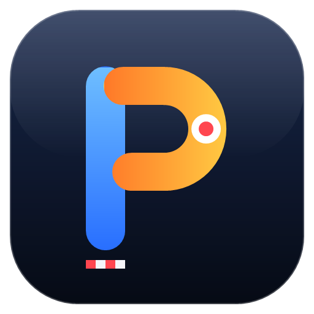

<h1 align="center">Lumicorsa</h1>

<b>Light for Assetto Corsa.</b> A photoreal look, an analog cluster HUD and every graphics, camera, 
drive, audio and sky setting in one panel. Runs inside Custom Shaders Patch; works on online servers like No Hesi.

---

## Install

1. Download `Lumicorsa-v2.0.1.zip` from [Releases](https://github.com/AllGASSNOBREAKSS/lumicorsa/releases).
2. Drag it onto Content Manager and click **Install** (it unpacks to `assettocorsa/apps/lua/Lumicorsa`).
3. Start a session. Needs Content Manager and CSP (built and checked against CSP 0.3.0-preview728).

If you used Photolap or Pitwall before, delete `apps/lua/Photolap` and `apps/lua/Pitwall`.

## Hotkeys

| Key | Does |
|---|---|
| Alt+P | Dashboard |
| Alt+O | Vanilla (bypass the look) |
| Alt+H | HUD on/off |
| Hold Q | Quick ring |
| Ctrl+K | Find any setting |

All of them can be rebound in CSP › Controls.

## Native vs optional ReShade

- **Native:** everything in Lumicorsa. The look is CSP Lua shaders, drawn under the HUD and apps. The settings write the same files Content Manager uses, and the cluster is drawn from the car's live data.
- **Optional ReShade:** System › Install ReShade downloads the official add-on build from reshade.me after you confirm. Lumicorsa never needs it, and Uninstall only removes a ReShade that Lumicorsa installed.
- **Works with NVIDIA DLSS when CSP has it enabled.** Lumicorsa is not DLSS 5 and ships no NVIDIA files. Its neural detail pass is a small open-source CNN.

## Good to know

- On online servers, weather, time and assists are set by the server. Those controls show as locked, with the reason.
- Some settings need an AC restart or apply next launch. Each one is labelled on its control.
- Effect costs are measured on your PC (System › Measure effect costs). Until then, cards say "not measured".
- System › Verification has the self-test, proof screenshots and a 10-minute online soak test.

## Font licence

The UI ships **Inter** and **JetBrains Mono** (SIL OFL). The design's FK Grotesk files are trial, personal-use only, and aren't included. Add FK Grotesk only with a commercial licence. Other notices are in [THIRD-PARTY-NOTICES.md](THIRD-PARTY-NOTICES.md).

MIT licence.
